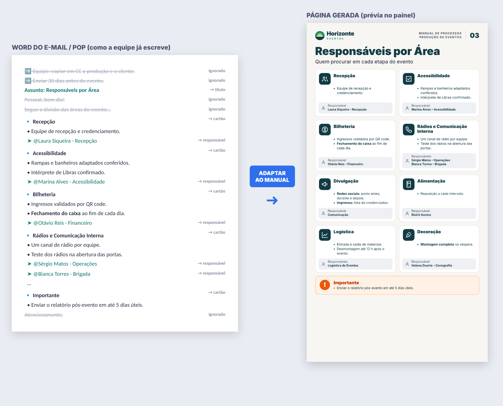
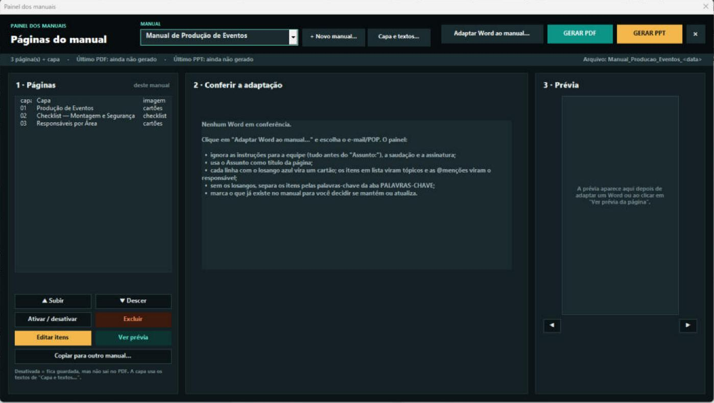
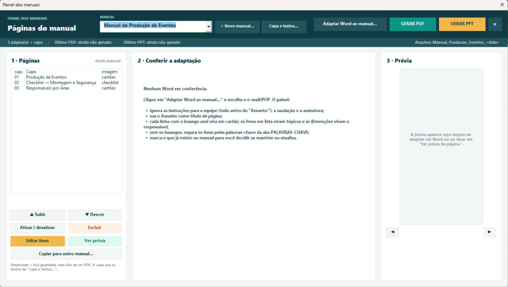
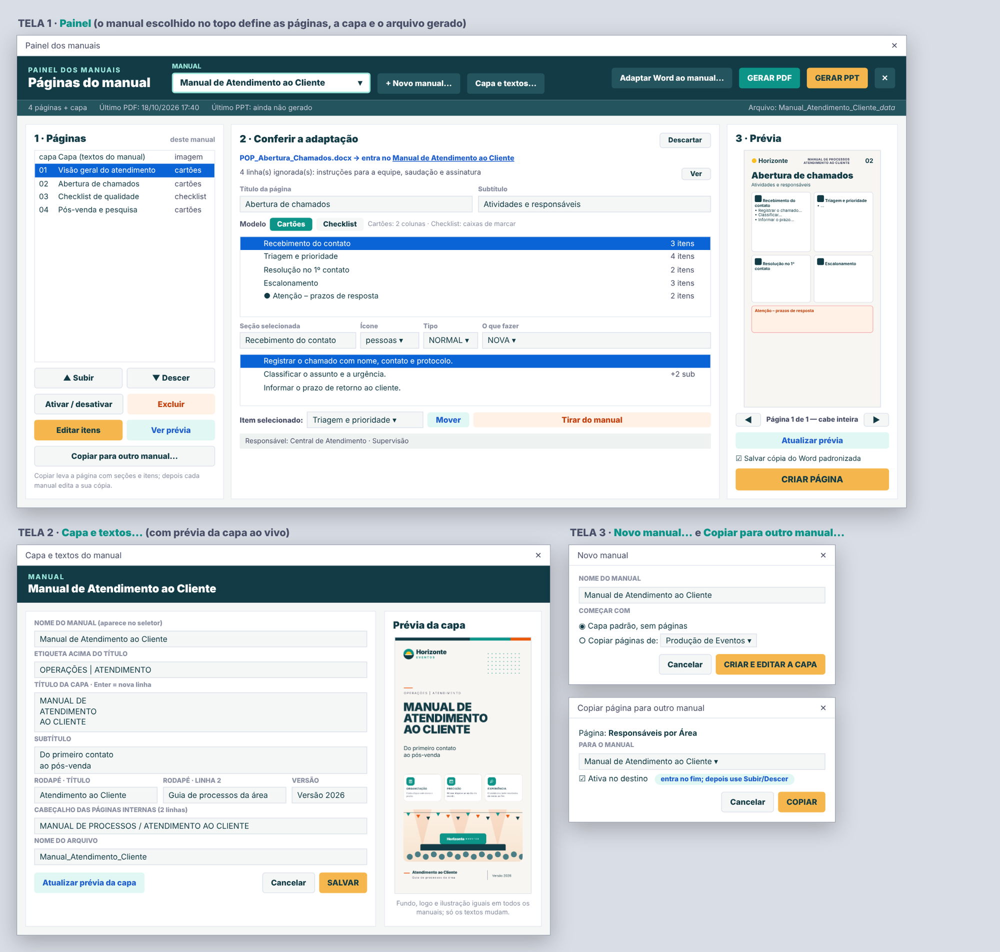
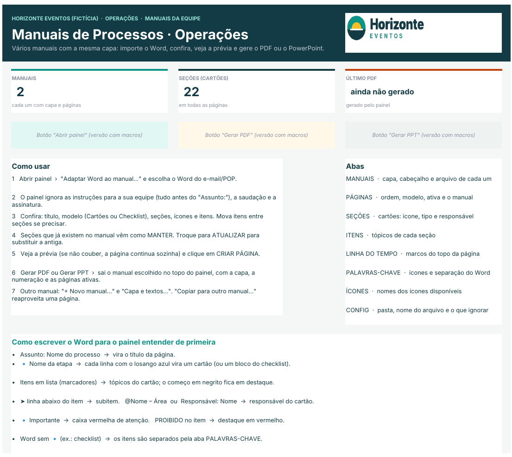
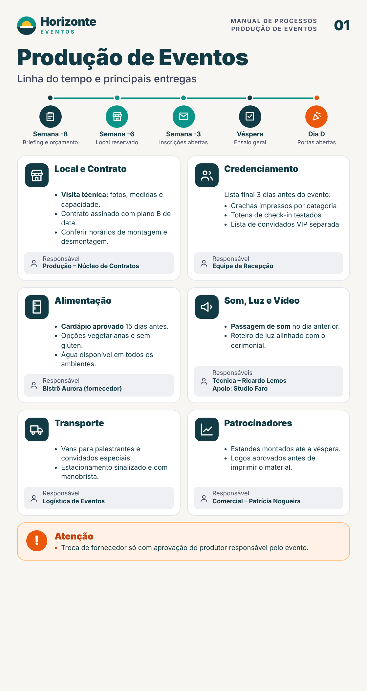
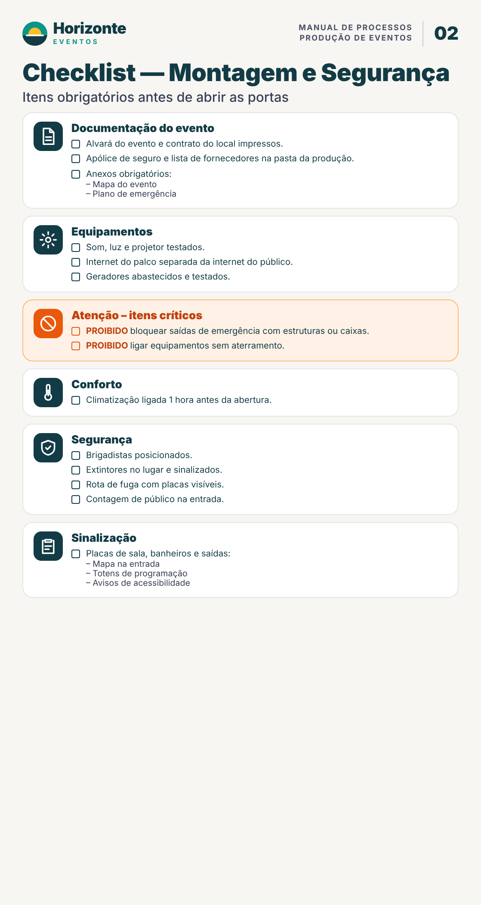
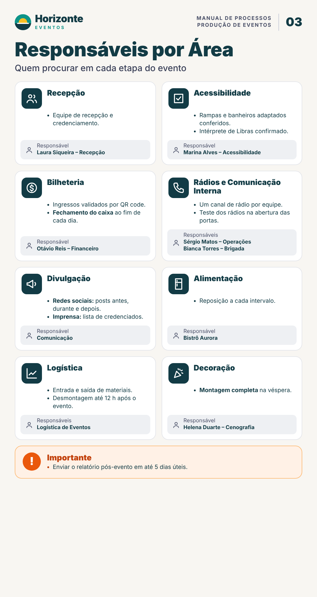

# Painel de Manuais de Processos (Excel + VBA)

Painel em **Excel/VBA** que transforma os e-mails e POPs de uma área (arquivos Word) em **manuais visuais padronizados**, com capa, ícones, cartões por etapa, responsáveis e checklists. O manual sai em **PDF** e em **PowerPoint**, sempre no mesmo modelo.

Os exemplos simulam uma produtora de eventos fictícia, com um manual de **Produção de Eventos** e outro de **Atendimento ao Cliente**. O painel serve para qualquer área que já documenta os seus processos em e-mails ou POPs.

> **Sobre este repositório**
> Este repositório é uma **vitrine**. As imagens, a planilha e os arquivos de exemplo usam **dados fictícios**: a empresa "Horizonte Eventos", as pessoas e os e-mails foram inventados.
> O **código-fonte (VBA) não está publicado**, porque o projeto é de uso interno. Veja a seção [Código-fonte](#código-fonte).

---

## O problema

- Os processos estavam espalhados em e-mails padrão e POPs no Word.
- Cada novo processo exigia remontar o manual à mão, no PowerPoint.
- Quem executava recebia textos longos, com instruções que só valiam para a equipe interna.

## A solução

Um painel no Excel que:

1. **Lê o Word do jeito que a equipe já escreve.** Não é preciso mudar o template.
2. **Ignora o que não é para quem executa:** as instruções internas antes do "Assunto:", a saudação e a assinatura.
3. **Adapta o texto ao modelo do manual:**
   - cada `🔹 etapa` vira um cartão com ícone;
   - os itens em lista viram tópicos, com o começo em negrito destacado;
   - as `@menções` e as linhas "Responsável:" viram o responsável do cartão.
4. **Mostra a prévia** da página exatamente como ela vai sair no PDF.
5. **Grava a página no manual.** Se não couber, cria a página de continuação sozinho.
6. **Gera o manual inteiro em PDF ou em PowerPoint,** em botões separados.

---

## Funcionalidades

| | |
|---|---|
| **Importar e adaptar o Word** | Separa o conteúdo em seções e itens. Reconhece o título, os subitens (`➤`), os responsáveis (`@Nome`), a caixa "Importante" e os itens com "PROIBIDO". |
| **Word sem seções** | Distribui os itens pelas **palavras-chave** de cada seção, em ordem de prioridade. O que não encaixa vai para "Outros (revisar)". |
| **Conferência antes de gravar** | Permite renomear a seção, trocar o ícone e o tipo (normal, crítico, atenção), mover itens entre seções e tirar itens do manual. |
| **Seções repetidas** | Detecta o que já existe no manual e oferece MANTER, ATUALIZAR ou INCLUIR de novo. |
| **Modelos de página** | **Cartões** (2 colunas com o responsável no rodapé) ou **Checklist** (caixas de marcar), com linha do tempo opcional no topo. |
| **Paginação automática** | Os cartões não quebram no meio. O que sobra vai para uma página de "Continuação". |
| **Editar páginas gravadas** | Tirar ou mover itens e excluir seções. A ordem é refeita ao salvar. |
| **Vários manuais** | Cada manual tem a sua capa, cabeçalho, nome de arquivo e páginas. Uma página pode ser **copiada** para outro manual. |
| **Capa editável** | O fundo e a ilustração são os mesmos em todos os manuais. Etiqueta, título, subtítulo, rodapé e versão são editados no painel, com prévia. |
| **Saída** | **PDF** para distribuir e **PPTX** editável, com a data no nome do arquivo. Se o arquivo do dia estiver aberto, salva com a hora. |
| **Cópia padronizada do Word** | Opcional: salva uma versão do Word no formato que o painel lê melhor. |

---

## Telas

### Painel rodando no Excel (tema escuro)

O tema fica na aba CONFIG (`TEMA = ESCURO` ou `CLARO`) e muda só as telas. O PDF e o PPT saem sempre com o visual claro do manual.

### Tema claro, com prévia gerada pelo PowerPoint

### Telas do painel

### Planilha (base do painel)

As abas da planilha são:

- **INÍCIO:** os botões e o passo a passo.
- **MANUAIS:** a capa e os textos de cada manual.
- **PÁGINAS**, **SEÇÕES**, **ITENS** e **LINHA DO TEMPO:** o conteúdo do manual. Tudo fica em tabelas, então dá para corrigir direto nelas.
- **PALAVRAS-CHAVE:** os ícones e a separação automática do Word.
- **ÍCONES:** a galeria de ícones.
- **CONFIG:** a pasta de saída e as linhas do Word que devem ser ignoradas.

### Páginas geradas

| Capa | Linha do tempo + cartões | Checklist | Cartões com responsáveis |
|---|---|---|---|
|  |  |  |  |

Com os mesmos dados, o painel gera outro manual com a mesma capa e textos diferentes:

---

## Exemplos (dados fictícios)

| Arquivo | O que é |
|---|---|
| [`exemplos/POP_Exemplo.docx`](exemplos/POP_Exemplo.docx) | Word de entrada no formato que a equipe usa: instruções internas, "Assunto:", seções 🔹 e @responsáveis. |
| [`exemplos/Planilha_Exemplo.xlsx`](exemplos/Planilha_Exemplo.xlsx) | A base do painel com dois manuais e três páginas. Só os dados: sem macros e sem imagens embutidas. |
| [`exemplos/Manual_Exemplo_Eventos.pdf`](exemplos/Manual_Exemplo_Eventos.pdf) | Exemplo de manual com capa e três páginas. |

---

## Tecnologias e técnicas

- **Excel VBA:**
  - formulários (UserForms) montados **inteiramente por código**, sem molduras;
  - eventos centralizados numa classe `WithEvents`;
  - botões planos feitos com Labels, no visual da identidade.
- **Automação do Word** (late binding): lê os parágrafos, os níveis de lista, o negrito do começo da linha, as quebras de linha e os emojis usados como marcadores.
- **Automação do PowerPoint:**
  - desenho vetorial de cada página: formas, caixas de texto com AutoSize para medir a altura e a paginação;
  - exportação para **PDF** e **PPTX**;
  - **prévia em JPG** exibida no formulário.
- **Dados em tabelas (ListObjects).** O painel lê e grava só pelas tabelas, sem endereços fixos de célula.
- **Imagens embutidas na planilha em Base64** (logo, capa e ícones). O arquivo funciona sozinho, sem pasta de imagens ao lado.
- **Instalador em um único `.bas`:** grava os módulos, as classes e os formulários no projeto VBA, cria os botões e **migra** planilhas de versões anteriores sem perder dados.

Os detalhes estão em [`docs/arquitetura.md`](docs/arquitetura.md) e [`docs/formato-do-word.md`](docs/formato-do-word.md).

---

## Código-fonte

O código VBA **não faz parte deste repositório**, porque o projeto é de uso interno.
Este repositório serve para apresentar o projeto: o problema, a solução, as telas e os resultados. Para conversar sobre o projeto ou ver uma demonstração, entre em contato pelo meu perfil.

## Licença

© 2026 — Todos os direitos reservados. As imagens e os exemplos são só para visualização (veja [LICENSE](LICENSE)).
