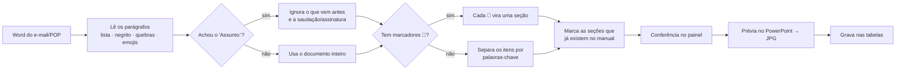

# Arquitetura (visão geral)

> Descrição conceitual. O código-fonte não está publicado.

## Componentes

| Componente | Papel |
|---|---|
| **Módulo principal** | Lê e grava as tabelas, importa e adapta o Word, desenha as páginas no PowerPoint, gera o PDF e o PPTX, monta a prévia e decodifica as imagens Base64. |
| **Classe Página** | Dados de uma página: título, subtítulo, modelo, seções e linha do tempo. |
| **Classe Seção** | Dados de uma seção: título, ícone, tipo, introdução, responsáveis, itens e a ação na importação. |
| **Classe Evento** | Recebe os cliques e as alterações de todos os controles criados por código e repassa ao formulário (`WithEvents`). |
| **Formulário do painel** | Páginas, conferência da adaptação e prévia. |
| **Formulário de apoio** | Capa e textos, novo manual e cópia de página. |
| **Instalador** | Um único `.bas` que grava os componentes, cria os botões e migra a planilha. |

## Fluxo da importação

## Desenho das páginas

- **Tamanho da página:** 419 × 787 pt, em formato retrato. O cabeçalho tem o logo, o nome do manual e o número da página.
- **Cartões:** ficam em duas colunas. A altura de cada linha é a do cartão mais alto, e o responsável vai alinhado ao rodapé.
- **Checklist:** blocos em largura total. As caixas de marcar ficam alinhadas à primeira linha de cada item.
- **Caixas de atenção e seções críticas:** em vermelho.
- **Paginação:** cada bloco é desenhado, medido e, se não couber, apagado e redesenhado numa página de continuação.

## Dados

Todo o conteúdo fica em tabelas do Excel:

| Tabela | O que guarda |
|---|---|
| Manuais | A capa e os textos de cada manual. |
| Páginas | A ordem, o modelo, se está ativa e o manual a que pertence. |
| Seções | Os cartões de cada página. |
| Itens | Os tópicos de cada seção. |
| Linha do tempo | Os marcos do topo da página. |
| Palavras-chave | Os ícones e a separação automática do Word. |
| Configurações | A pasta de saída, o nome do arquivo e o manual escolhido. |
| Linhas ignoradas | O começo das linhas do Word que não entram no manual. |
| Imagens | O logo, a capa e os ícones, em Base64. |
